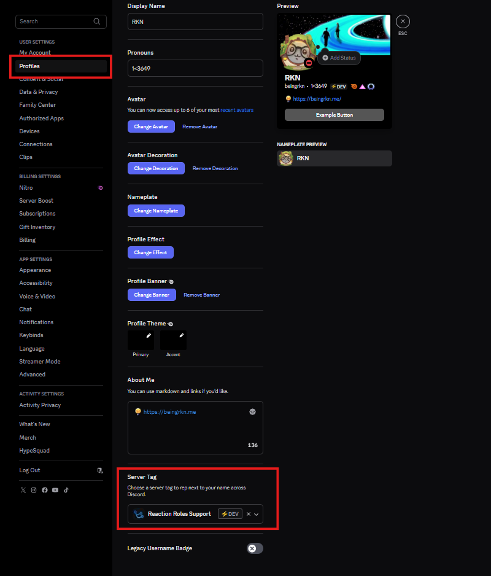

# 🌐 Discord Guild Tags — How to Claim Yours (2025)
 
> ⚠️ **Note:** Our server **Mr. Random** currently **does not have access** to the Guild Tag feature. This guide is meant to help you explore and claim tags from other guilds that do have access.
 
---
 
## 🛠️ What are Discord Guild Tags?
 
Discord is rolling out an experimental feature called **Guild Tags**, which allows a server to set a unique **tag**. Once you're part of such a server, you can choose to display that tag publicly on your **Discord profile**, giving your profile a personalized flair linked to your favorite community.
 
---
 
## 📥 How to Claim a Guild Tag
 
1. Join any of the servers listed below.
2. Once you're in one or more Guild Tag-enabled servers, go to your **Profile Settings**.
3. Scroll down to find the **Server Tag** section.
4. Choose the tag you want to display publicly on your profile!
 
📸 *Image Tutorial:*  
  
 
---
 
## 📚 Guild Tags Directory
 
Click any tag below to jump to the invite link and details.
 
- [💀BRUH](#-bruh)
- [💙CAT](#-cat)
- [🩷CUTE](#-cute)
- [⚔️CYBR](#-cybr)
- [⚡DEV](#-dev)
- [🍃DINO](#-dino)
- [🍄DUAL](#-dual)
- [🔥EMH](#-emh)
- [⚔️EZ](#-ez)
- [💀iOS](#-ios)
- [🩷LGBT](#-lgbt)
- [💜MEOW](#-meow)
- [⚔️MOCO](#-moco)
- [🔷POLAR](#-polar)
- [🍃PRO](#-pro)
- [❤️‍🔥RAWR](#rawr)
- [🍃SOUL](#-soul)
- [🩷TIT](#-tit)
- [⚔️VALC](#-valc)
- [⚡VIP](#-vip)
 
---
 
## 🎯 Guild Tag Servers
 
### 🔹 💀BRUH
**Tag:** `BRUH`  
**Server:** *La cueva de Cosi*  
**Invite:** [Join BRUH Server](https://discord.gg/la-cueva-de-cosi-844285068275875890)
 
---
 
### 🔹 💙CAT
**Tag:** `CAT`  
**Server:** *Sanic*  
**Invite:** [Join CAT Server](https://discord.gg/Hgb5rjxaKR)
 
---
 
### 🔹 🩷CUTE
**Tag:** `CUTE`  
**Server:** *The Cute Bakery*  
**Invite:** [Join CUTE Server](https://discord.gg/Ta7mtrADZA)
 
---
 
### 🔹 ⚔️CYBR
**Tag:** `CYBR`  
**Server:** *Cyber Info*  
**Invite:** [Join CYBR Server](https://discord.gg/cyberinfo)
 
---
 
### 🔹 ⚡DEV
**Tag:** `DEV`  
**Server:** *Reaction Roles Support*  
**Invite:** [Join DEV Server](https://discord.gg/reactionroles)
 
---
 
### 🔹 🍃DINO
**Tag:** `DINO`  
**Server:** *Isla Sorna*  
**Invite:** [Join DINO Server](https://discord.gg/MZ8hhJ7dCh)
 
---
 
### 🔹 🍄DUAL
**Tag:** `DUAL`  
**Server:** *DualView*  
**Invite:** [Join DUAL Server](https://discord.gg/dualview)
 
---
 
### 🔹 🔥EMH
**Tag:** `EMH`  
**Server:** *Emergency Hamburg*  
**Invite:** [Join EMH Server](https://discord.gg/emh)
 
---
 
### 🔹 ⚔️EZ
**Tag:** `EZ`  
**Server:** *VALORANT IL*  
**Invite:** [Join EZ Server](https://discord.gg/valorantil)
 
---
 
### 🔹 💀iOS
**Tag:** `iOS`  
**Server:** *r/Jailbreak*  
**Invite:** [Join iOS Server](https://discord.gg/jb)
 
---
 
### 🔹 🩷LGBT
**Tag:** `LGBT`  
**Server:** *Pridecord*  
**Invite:** [Join LGBT Server](https://discord.gg/lgbtqia)
 
---
 
### 🔹 💜MEOW
**Tag:** `MEOW`  
**Server:** *Shaun's Cloud ✦*  
**Invite:** [Join MEOW Server](https://discord.gg/shaun)
 
---
 
### 🔹 ⚔️MOCO
**Tag:** `MOCO`  
**Server:** *joinmoco*  
**Invite:** [Join MOCO Server](https://discord.gg/moco)
 
---
 
### 🔹 🔷POLAR
**Tag:** `POLAR`  
**Server:** *POLAR*  
**Invite:** [Join POLAR Server](https://discord.gg/polarguild)
 
---
 
### 🔹 🍃PRO
**Tag:** `PRO`  
**Server:** *Creators Area*  
**Invite:** [Join PRO Server](https://discord.gg/gca)
 
---
 
### 🔹 ❤️‍🔥RAWR
**Tag:** `RAWR`  
**Server:** *╚» Gameland & Friends «╝*  
**Invite:** [Join RAWR Server](https://discord.gg/gamersland)
 
---
 
### 🔹 🍃SOUL
**Tag:** `SOUL`  
**Server:** *Celestrial Boundaries*  
**Invite:** [Join SOUL Server](https://discord.gg/celestrials)
 
---
 
### 🔹 🩷TIT
**Tag:** `TIT`  
**Server:** *TitsRP*  
**Invite:** [Join TIT Server](https://discord.gg/titsrp)
 
---
 
### 🔹 ⚔️VALC
**Tag:** `VALC`  
**Server:** *Valcraft - play.valc.gg*  
**Invite:** [Join VALC Server](https://discord.gg/valcraft)
 
---
 
### 🔹 ⚡VIP
**Tag:** `VIP`  
**Server:** *Nico's Safe Space*  
**Invite:** [Join VIP Server](https://discord.gg/nico-vip)
 
---
 
## ⭐ Stay Updated
 
This feature is experimental, so things may change! Star this gist and check back for updates.
